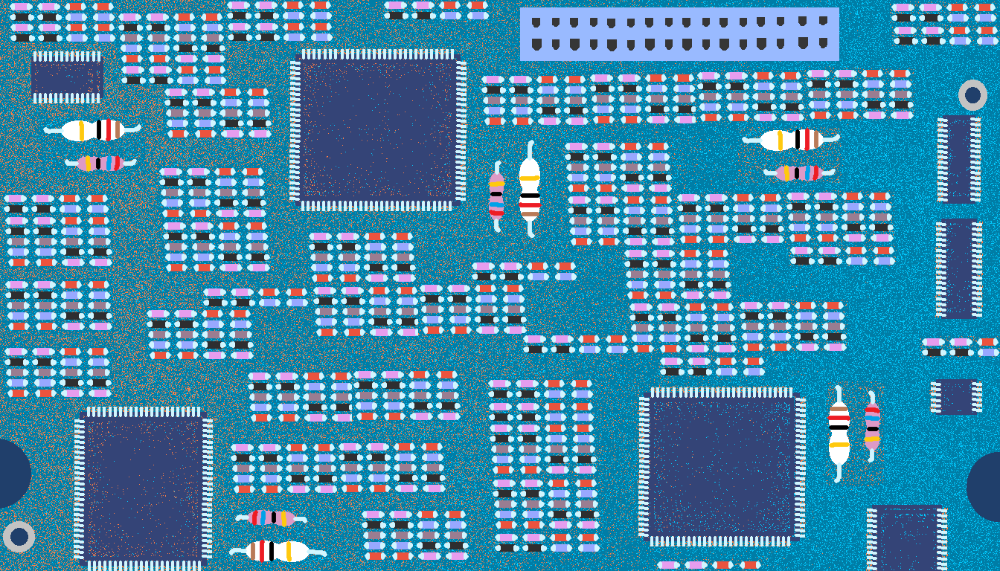
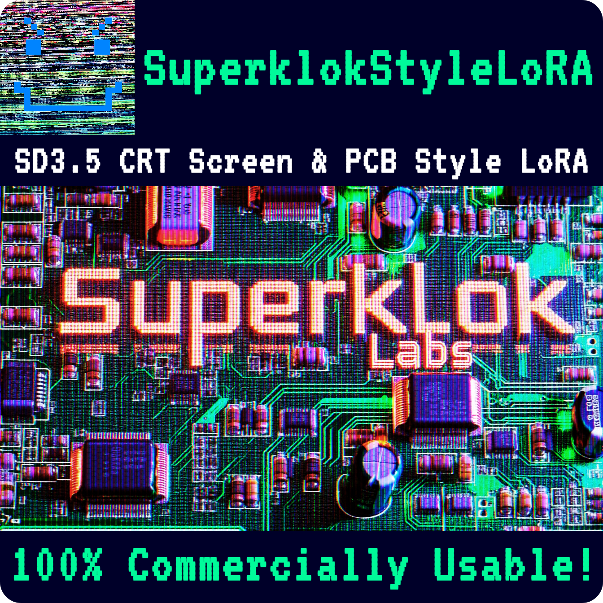
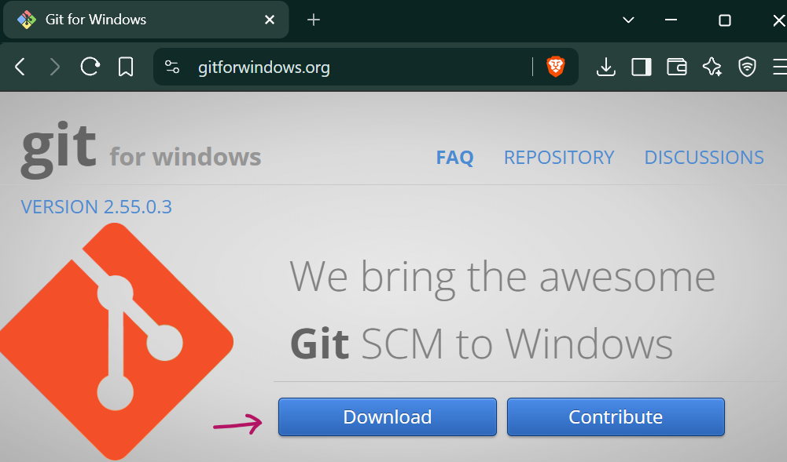
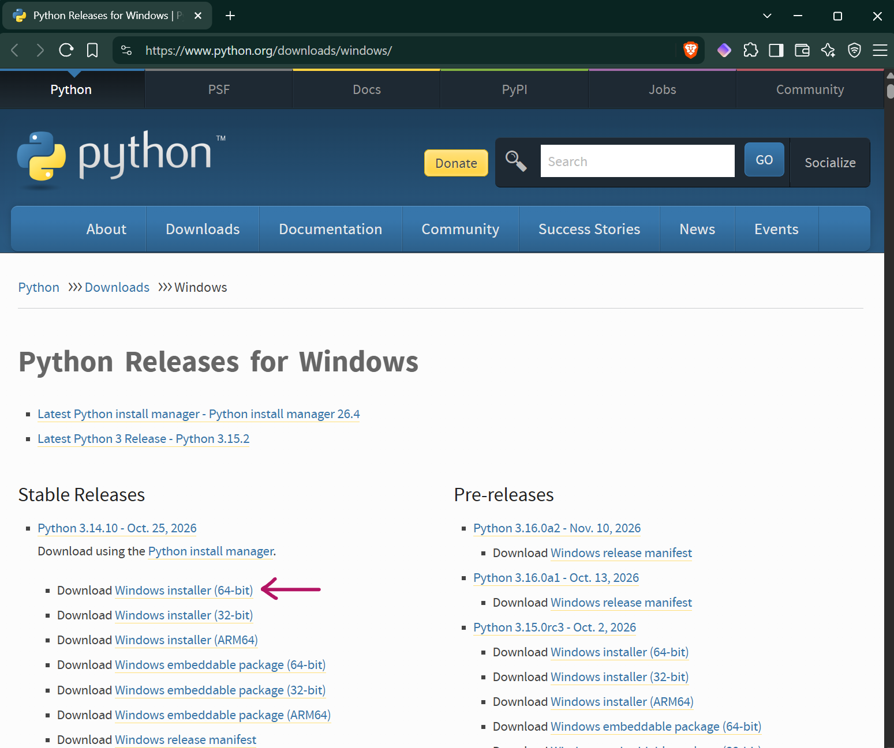
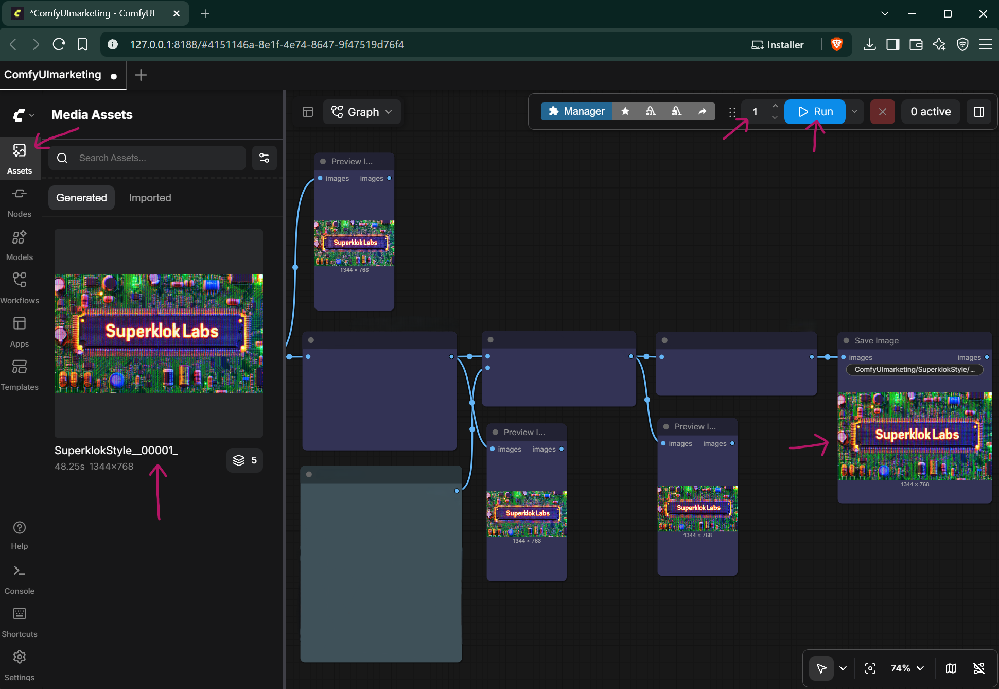
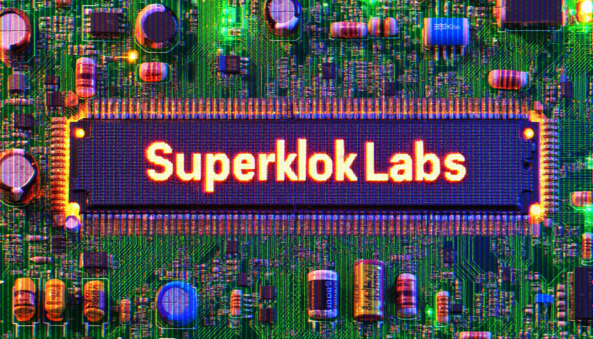

# 📺 SuperklokStyleLoRA: 100% Commercially Usable Style LoRA v1.12.0


`SuperklokStyleLoRA` is a 100% Commercially Usable specialized style fine-tuning model architecture trained natively on **Stable Diffusion 3.5 Large** using an all-in-one local ComfyUI interface. Visit [Hugging Face](https://huggingface.co/Superklok/SuperklokStyleLoRA/blob/main/SuperklokStyleLoRA.safetensors) to download `SuperklokStyleLoRA` for FREE!

This LoRA reproduces ultra-saturated, neon-green circuit board backgrounds, copper soldering points, glossy hardware capacitors, and authentic analog horizontal CRT television monitor scanlines.

---

## 💵 The Ultimate Commercial Core
Unlike LoRAs and workflows tied to restrictive non-commercial licenses, **this entire architecture is 100% free for commercial use.** 

(NOTE: Stable Diffusion 3.5 Large is 100% Commercially Usable up to an annual revenue of under USD $1 million.)

* **Indie Game Devs:** Generate menus, title screens, and concept art locally.
* **Content Creators:** Automate flashy and unique marketing image generation.
* **IP Creators:** Monetize your original marketing images, workflows, and visual outputs with zero subscription overhead.

`SuperklokStyleLoRA` was created with the help of `MarketingToolkitSL`, which specializes in turning primitive MS Paint drawings, combined with text prompts, into highly detailed 100% commercially usable images. The original uploaded reference image `Superklok Labs Banner.png` for the `SuperklokStyleLoRA` began as a primitive MS Paint drawing, here are the steps of its development using `MarketingToolkitSL` workflows.

 ➡️ ⤵️
 ➡️ 

Visit [Upwork](https://www.upwork.com/freelancers/~01a2b86360ffeb733e)/[Contra](https://contra.com/Superklok) to get your copy of the `MarketingToolkitSL` 100% commercially usable marketing automation engine today!

---

## 📊 Model Technical Details



* **Base Architecture Compatibility:** Stable Diffusion 3.5 Large (fp8 scaled / fp16 / bf16)
* **Native Trained Resolution:** 1344x768 (Landscape centered-crop dataset layout)
* **Required Activation Token:** `Superklok Style`
* **Recommended Weight:** `0.5 - 0.8` (Style models naturally thrive at slightly lower weights to preserve creative composition flexibility. Feel free to experiment with different values outside of the universal recommendation of `0.5 - 0.8` for style LoRAs, to see how it affects the final output image.)
* **Dataset Density:** 120 hand-selected art style images at 20 processing iterations per file (2,700 total training steps).
* **Final loss value**: `0.1404`, a stellar, textbook-perfect score for an intricate Style LoRA. Style models naturally hold a slightly higher final loss value than characters (for example, 0.10 to 0.15 vs [SunnyChuxemLoRA](https://github.com/Superklok/SunnyChuxemLoRA) character LoRA's 0.02). This is exactly what we want because it prevents the model from being rigid. It captured the layout texture, the scanlines, and the branding layout without losing its creative flexibility.

---

## 🚀 Native ComfyUI Training Architecture
This repository includes the official `ComfyUI Workflow - SuperklokStyleLoRA - SD3.5Large.json` workflow file. Users can train this model locally entirely within ComfyUI without installing terminal command suites, command-line environments, or complex external dependencies.

### ⚙️ System Requirements
* **Recommended Operating System:** Windows 11
* **Minimum Processor:** Intel Core i5-10400
* **Memory:** 32GB RAM
* **Recommended Graphics Card:** Nvidia RTX 50 Series GPU - Minimum 16GB VRAM
* **Required Storage Space:** 25GB

---

## INSTALLATION GUIDE

## 🎨 Step-by-Step Setup: Automated Installation Guide

**SuperklokStyleLoRA** features a completely portable, 100% offline-capable architecture. All application frameworks, neural weights, and local dependencies live entirely inside your main target project folder. Follow these steps to configure the image-generation pipeline. This workflow is optimized to run on a single 16GB VRAM graphics card.

---

> ⚠️ **IMPORTANT NOTE:** Download the **SuperklokStyleLoRA** GitHub repository directly to the folder location where you intend to run your applications. **SuperklokStyleLoRA** is a fully portable and 100% offline-capable environment. All related application files, models, and caches live strictly inside the main installation folder. Once set up, you can completely disconnect your system from the internet without losing any functionality.

### Step 1: Install ComfyUI (Portable Windows Build)



1. You will first need to install Git for Windows from the official page (https://gitforwindows.org/). The direct download link is https://github.com/git-for-windows/git/releases/download/v2.55.0.windows.3/Git-2.55.0.3-64-bit.exe



2. Download and install the newest version of Python for Windows from the official page (https://www.python.org/downloads/windows/). The direct download link for the 64-bit Windows installer is https://www.python.org/ftp/python/3.14.10/python-3.14.10-amd64.exe

> ⚠️ **NOTE:**Make sure to check "Add Python to PATH" when installing the newest version of Python.

3. Download or clone this repository (`SuperklokStyleLoRA/`) directly to the location on your hard drive where you intend to run the application.

 ➡️ 

4. Open a standard terminal window directly inside the main `SuperklokStyleLoRA/` directory path (Type `cmd` in your Windows file explorer address bar and press **Enter**).

 ➡️ 

5. Run the automated visual installer script using the native Python command:

```bash
python SuperklokStyleLoRA-comfyui-installer.py
```


The background engine will autonomously download the portable ComfyUI base, resolve the proprietary BCJ2 block filters using a temporary extractor asset, clone the `ComfyUI-Manager` core layers, fetch the 13.9GB Stable Diffusion 3.5 Large checkpoint, and automatically wire your local training image dataset folder (`dataset/20_SuperklokStyle/`) directly into the pipeline ingestion loops.

---

### Step 2: Load the Automated Workflow & Dependencies 


1. Browse to your newly provisioned `SuperklokStyleLoRA\ComfyUI_windows_portable\` folder and double-click the `run_nvidia_gpu.bat` file. A browser window will open automatically at `http://127.0.0.1:8188`. It may take a couple minutes to launch for the first time after installing ComfyUI.

2. Locate the `ComfyUI Workflow - SuperklokStyleLoRA - SD3.5Large.json` workflow file inside the `SuperklokStyleLoRA\` folder.

 ➡️ 

3. Drag and drop the `ComfyUI Workflow - SuperklokStyleLoRA - SD3.5Large.json` workflow file directly into the ComfyUI browser interface to load the automated pipeline.


4. Enter the number of LoRAs you would like to train sequentially, then press `Run` to train the amount of LoRAs you requested. Your trained LoRA `.safetensors` files can be found in the `SuperklokStyleLoRA\ComfyUI_windows_portable\ComfyUI\output\models\loras` folder.


When training your own LoRAs, you can use the `captioner.py` script found in your `SuperklokStyleLoRA\` folder to create `.txt` files to accompany each of your LoRA training images.


If you're interested in owning a custom version of the same Premium ComfyUI Workflow that generated the images used to train `SuperklokStyleLoRA`, then reach out through [Upwork](https://www.upwork.com/freelancers/~01a2b86360ffeb733e) or [Contra](https://contra.com/Superklok) to order your very own custom copy of the `MarketingToolkitSL` 100% Commercially Usable Marketing Automation Engine today! Here's an output sample from using the `SuperklokStyleLoRA` through the `MarketingToolkitSL` workflows:

 



Your 100% Commercially Usable LoRA training workflow is ready to go, and the parameters can easily be modified to train your own custom LoRAs!

---

# 🫧 SuperklokStyleLoRA: Core Training Node Architecture Breakdown

This section details the specific node pathways, hyperparameter weights, and local tensor logic utilized within the `ComfyUI Workflow - SuperklokStyleLoRA - SD3.5Large.json` local optimization pipeline.

## 📥 Dataset Ingestion & Processing Layers

### Load Image Text Dataset From Folder (`LoadImageTextDataSetFromFolder`)
* **Purpose:** Batches raw visual style training layers paired with text caption sheets simultaneously.
* **Key Configuration:** `folder`: `20_SuperklokStyle`.
* **Function:** Points directly to your internal database directory, grabbing your 120 gold-standard reference frames alongside their matching `.txt` prompt descriptive files.

### Make Training Dataset (`MakeTrainingDataset`)
* **Purpose:** Packs style image pixels and text strings into standardized mathematical training arrays.
* **Key Configuration:** Inputs dynamically linked to the base checkpoint’s VAE and CLIP networks.
* **Function:** Compresses raw high-resolution pixel boundaries down into unrendered latent maps using the model's native VAE visual encoder, while transforming descriptive text scripts into clean conditioning tensors via the CLIP network.

---

## 🤖 Base Loading & Training Engine

### Checkpoint Loader Simple (`CheckpointLoaderSimple`)
* **Purpose:** Initializes the foundational multi-modal diffusion network.
* **Key Configuration:** `ckpt_name`: `sd3.5_large_fp8_scaled.safetensors`.
* **Function:** Loads the primary Stable Diffusion 3.5 framework blocks, splitting the logic signal into the central MODEL workspace, text routing filters (CLIP), and data converters (VAE).

### Train LoRA Node (`TrainLoraNode`)
* **Purpose:** Computes matrix error weights to isolate and bake intricate art styles locally.
* **Key Configuration:** 
  * `batch_size`: 2
  * `grad_accumulation_steps`: 1
  * `steps`: 2700
  * `learning_rate`: 0.00003 (`3e-5`)
  * `Rank`: 32
  * `optimizer`: "AdamW"
  * `loss_function`: "MSE"
  * `training_dtype`: "bf16"
  * `lora_dtype`: "bf16"
  * `quantized_backward`: true
  * `Algorithm`: "LoRA"
  * `gradient_checkpointing`: true
  * `checkpoint_depth`: 2
  * `Offloading`: true
* **Function:** The core synthesis layer of the pipeline. It maps custom textures, CRT monitor aesthetics, and neon-green circuitry across **2,700 total iterations** using modern AdamW mathematical solvers. The learning rate is tuned slightly higher (`3e-5`) than typical character pipelines to ensure complex geometric layouts are aggressively absorbed. It leverages critical hardware configurations like `quantized_backward`, memory `offloading`, and `gradient_checkpointing` to drop VRAM requirements drastically, allowing stable execution within consumer GPU layouts.

---

## 💾 Output Processing

### Save LoRA (`SaveLoRA`)
* **Purpose:** Writes the completed, fine-tuned network weights permanently to disk storage.
* **Key Configuration:** `filename_prefix`: `models/loras/SuperklokStyleLoRA`.
* **Function:** Finalizes data processing loops and outputs a ready-to-run `.safetensors` model file directly into your local ComfyUI directory tree.

---

# 🪾 SuperklokStyleLoRA Repository File Tree

```text
📁 SuperklokStyleLoRA/                 (Main Fine-Tuning Art Style Workspace Folder)
  ├── 📄 captioner.py                  (Automated Dataset Text Processing Script)
  ├── 📄 ComfyUI Workflow - SuperklokStyleLoRA - SD3.5Large.json (Training Automation Script)
  ├── 📄 CONTENTS.txt                  (Raw Directory Layout Export Data)
  ├── 📄 FUNDING.yml                   (Project Support & Sponsorship Info)
  ├── 📄 LICENSE                       (Unified Public Asset License v1.0 File)
  ├── 📄 README.md                     (Main Repository Documentation Workspace)
  ├── 📄 README.pdf                    (Portable Document Format Documentation)
  ├── 📄 superklokstylelora-comfyui-installer.py (Portable ComfyUI Installer Script)
  │
  ├── 📁 Assets/                        (Workflow Graphic Assets & Typography Elements)
  │     ├── 📄 CircuitBoard - Superklok Labs Writing.png
  │     ├── 📄 CircuitBoard.png
  │     ├── 📄 CRT Screen 24x24px Tiles.png
  │     ├── 📄 CRT Screen 32x32px Tiles.png
  │     ├── 📄 CRT Screen 50x50px Tiles.png
  │     ├── 📄 CRT Tile.png
  │     ├── 📄 Superklok Labs Banner.png
  │     └── 📄 VT323-Regular.ttf
  │
  ├── 📁 dataset/                       (Active Machine Learning Input Workspace)
  │     └── 📁 20_SuperklokStyle/        (120 Art Style Images + 120 Caption Text Sheets)
  │
  ├── 📁 Output Samples/                 (Generative Sample Production Outputs 1-6)
  │
  ├── 📁 Promo/                          (Gumroad Cover Artwork and Marketing Panels 1-5)
  │
  ├── 📁 Screenshots/                    (Documentation Step-by-Step UI System Previews)
  │
  └── 📁 SuperklokStyleLoRA Training Images/ (Original Isolated 120 Dataset Visual Layers)
```

---

# 🚀 100% Commercial Use ComfyUI Workflow & SuperklokStyleLoRA

**SuperklokStyleLoRA** is a Superklok Labs production-grade style asset and LoRA purpose-built for applying the Superklok art style to AI generated imagery. 

Unlike traditional assets, this style LoRA is released with **zero commercial restrictions**. You are fully authorized to use this asset in commercial video games, software applications, marketing campaigns, and creative projects completely free of charge.

---

## 🛠️ Need Custom ComfyUI Workflows or AI Pipelines?
While this style LoRA is completely free, achieving perfect consistency, hyper-speed rendering, and automated production pipelines requires specialized engineering. 

If you need a custom-built generation pipeline, bespoke style LoRAs for your brand, or optimized ComfyUI enterprise workflows, let's build it together!

**Hire me directly on your preferred freelance platform:**
* 💼 **Hire on [Upwork](https://www.upwork.com/freelancers/~01a2b86360ffeb733e)**
* ⚡ **Hire on [Contra](https://contra.com/Superklok)**
* 🌐 **Portfolio on [GitHub](https://github.com/Superklok)**

---

## 📊 Benchmark Capabilities
The `SuperklokStyleLoRA` asset is explicitly engineered to test the limits of your generative pipelines:
* **High-Fidelity Consistency:** Perfect for testing seed stability, IP-Adapter configurations, and ControlNet weighting.
* **SFW / Production-Ready:** Clean, professional aesthetics suitable for corporate demos, marketing campaigns, and open-source testing.
* **Architecture Agnostic:** Optimized for seamless integration across Stable Diffusion architectures and custom ComfyUI nodes.

---

## 📜 License & Commercial Use (Summary)

This repository is distributed under the **SUPERKLOK LABS UNIFIED PUBLIC ASSET LICENSE v1.0**. 

* **100% Free for Commercial Use**: You are fully permitted to use the ComfyUI workflows, LoRA models, and test images to generate commercial artwork.
* **Mandatory Attribution**: You must credit **Superklok Labs** by linking to or tagging one of the official handles (for example, [Twitter(X)](https://x.com/SuperklokLabs) or [Instagram](https://www.instagram.com/superkloklabs/)) whenever you publish content created or upscaled with these assets.

See the full [LICENSE](LICENSE) file for legal details and the complete list of attribution links.

---

💡 *If you find this project useful, reach out via [Upwork](https://www.upwork.com/freelancers/~01a2b86360ffeb733e)/[Contra](https://contra.com/Superklok) to scale up your studio's AI infrastructure!*